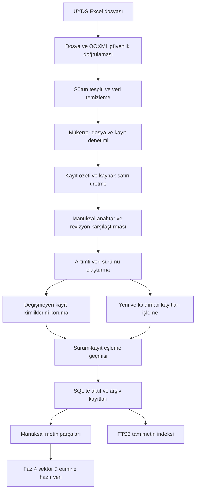

# UYDS Akıllı SSS Destek Asistanı

Sürüm 1.0.0 | Faz 1-3 tamamlandı | Geliştirme sürümü | MIT Lisansı

## Proje Durumu

HadesBot, UYDS Sık Sorulan Sorular verilerini güvenli biçimde hazırlamak, anlamsal olarak aranabilir hale getirmek ve sonraki fazlarda kaynak kontrollü bir destek asistanına dönüştürmek amacıyla geliştirilmektedir.

Mevcut sürüm; güvenli uygulama altyapısını, SQLite ve FTS5 veri katmanını, Excel içe aktarımını, veri sürümlemeyi ve metin parçalamayı içerir. Vektör tabanlı arama, hibrit sıralama, DeepSeek yanıt üretimi, kullanıcı API’leri ve web arayüzü henüz uygulanmamıştır.

| Faz | Kapsam | Durum |
|---|---|---|
| Faz 1 | Ortam, Docker, yapılandırma ve güvenlik altyapısı | Tamamlandı |
| Faz 2 | SQLite, FTS5, veri modelleri ve şifreleme | Tamamlandı |
| Faz 3 | Excel aktarımı, sürümleme ve metin parçalama | Tamamlandı |
| Faz 4 | Vektör gömmeleri ve kurum içi terim haritası | Beklemede |
| Faz 5 | Hibrit arama, RRF ve yeniden sıralama | Beklemede |
| Faz 6 | DeepSeek, kaynak kontrollü RAG, SSE ve oturum hafızası | Beklemede |
| Faz 7 | API rotaları, kimlik doğrulama ve merkezi hata yönetimi | Beklemede |
| Faz 8 | Geri bildirim, yönetici onayı ve analitik | Beklemede |
| Faz 9 | Kurumsal web arayüzü | Beklemede |
| Faz 10 | Kalıcı testler, benchmark ve güvenlik doğrulaması | Beklemede |

## Veri Gizliliği

UYDS Excel dosyaları, soru-cevap içerikleri, SQLite veritabanları, vektör kayıtları, günlükler, yedekler ve proje çıktıları özel kurumsal veridir. Bu dosyalar GitHub, kişisel bulut depolama, e-posta veya harici dosya paylaşım servislerine aktarılmamalıdır.

`veriler/` ve `yedekler/` dizinleri sürüm kontrolü ile Docker imaj bağlamından çıkarılmıştır. Gerçek veri yalnızca yetkili yerel çalışma ortamında tutulmalıdır.

## Tamamlanan Özellikler

### Uygulama ve güvenlik altyapısı

- FastAPI uygulama yaşam döngüsü ve sağlık kontrolü
- Ortam profilleri: `dev`, `test`, `prod`
- Zorunlu ve doğrulanan JWT, veritabanı şifreleme ve yönetici parolası değerleri
- Yapılandırılabilir istek sınırı ve akış tabanlı istek gövdesi boyut kontrolü
- Güvenlik başlıkları ve sınırlı CORS politikası
- SQLite üzerinde merkezi kullanıcı ve IP brute-force sayaçları
- bcrypt tabanlı parola özetleme
- JWT oluşturma, çözme ve RBAC bağımlılık altyapısı
- Hassas değer maskeleyen yapılandırılmış günlükleme
- Non-root Docker kullanıcısı, capability kaldırma ve `no-new-privileges`
- Ayrı liveness ve veritabanı/FTS readiness kontrolleri
- PID sınırı ve kontrollü kapanış süresi

### Veritabanı altyapısı

- Bağlantı başına SQLite yönetimi
- WAL, foreign key ve busy timeout ayarları
- 12 normal tablo ve bir FTS5 sanal tablosu
- INSERT, UPDATE ve DELETE işlemlerinde FTS5 eşitleme tetikleyicileri
- Tek seferlik ve kayıtlı şema migrasyonları
- Durum, puan ve boolean alanları için veritabanı doğrulama kısıtları
- Arama, sürüm, parça, vektör ve oturum sorgularına uygun indeksler
- Veri sürümleri ile SSS kayıtlarını, kaynak sayfa ve satır anlık görüntüsüyle eşleyen kalıcı ilişki tablosu
- AES-256-GCM ile doğrulanmış veritabanı şifreleme
- PBKDF2-HMAC-SHA256 anahtar türetme
- Temiz kapanışta WAL checkpoint, bütünlük kontrolü ve düz metin temizliği
- Atomik yedekleme, geri yükleme, saklama sınırı ve zamanlama

### Excel veri aktarımı

- Standart `Kategori`, `Soru`, `Cevap`, `Kaynak Doküman` şeması
- Mevcut kurumsal UYDS Excel şeması
- İlk 25 satır içinde dinamik başlık tespiti
- Dosya boyutu, MIME, OOXML imzası ve içerik türü doğrulaması
- ZIP path traversal, sıkıştırma bombası, makro, OLE, ActiveX ve harici bağlantı denetimi
- Formül ve formül enjeksiyonu reddi
- SHA-256 ile aynı dosyanın yeniden aktarılmasını engelleme
- Dosya içindeki birebir mükerrer kayıtları eleme
- Excel çalışma sayfası, satır numarası ve kayıt özeti izlenebilirliği
- Değişmeyen kayıt kimliklerini ve parçalarını koruyan artımlı sürümleme
- Tekil mantıksal anahtarlarda önceki kayıt bağlantısı ve alan bazlı revizyon geçmişi
- Yeni kayıtta 1 ile başlayan ve her içerik revizyonunda bağımsız artan içerik sürümü
- Yalnızca kaldırılan veya değişen kayıtları arşivleme
- Süreçler arası `BEGIN IMMEDIATE` aktarım kilidi ve benzersiz dosya özeti
- Veri yazmadan eklenen, güncellenen, korunan ve kaldırılan kayıtları raporlayan kuru çalışma
- Geçmiş veri üyeliğini yeni ve denetlenebilir bir sürüm olarak etkinleştiren geri alma
- Denetim günlüğü ve veri sürümü geçmişi
- Paragraf, satır ve cümle sınırlarını koruyan metin parçalama

## Mevcut Veri Akışı



Gerçek UYDS çalışma kitabında 2.399 veri satırı okunmuş, birebir mükerrer bir satır elendikten sonra 2.398 benzersiz kayıt ve 4.075 metin parçası oluşturulmuştur. Gerçek içerikler ve üretilen veritabanı sürüm kontrolüne dahil edilmez.

## Planlanan Özellikler

- Yerel Türkçe sentence-transformer modeli ile vektör üretimi
- FTS5 ve kosinüs benzerliğini birleştiren hibrit arama
- Reciprocal Rank Fusion ve Cross-Encoder yeniden sıralama
- DeepSeek API ile yalnızca seçilen kaynaklardan yanıt üretimi
- Düşük güvenli ve cevapsız sorularda yanıt reddetme
- Server-Sent Events ile canlı yanıt akışı
- Kullanıcı oturum hafızası
- JWT giriş, yenileme ve çıkış rotaları
- Kullanıcı geri bildirimi ve yönetici onayı
- Analitik ve yönetici panelleri
- Kurumsal web arayüzü
- Benchmark, pytest ve güvenlik testi altyapısı

## Teknoloji Yığını

| Bileşen | Teknoloji | Kullanım durumu |
|---|---|---|
| Programlama dili | Python 3.11 | Aktif |
| Web çatısı | FastAPI | Aktif |
| ASGI sunucusu | Uvicorn | Aktif |
| Veritabanı | SQLite3 ve FTS5 | Aktif |
| Veri işleme | Pandas ve OpenPyXL | Aktif |
| Veri doğrulama | Pydantic ve Pydantic-Settings | Aktif |
| Şifreleme | cryptography, AES-256-GCM | Aktif |
| Parola güvenliği | bcrypt | Aktif |
| İstek sınırlama | SlowAPI | Aktif |
| Konteyner | Docker ve Docker Compose | Aktif |
| Vektör gömmeleri | Sentence-Transformers ve NumPy | Faz 4 için planlandı |
| Yeniden sıralama | Cross-Encoder | Faz 5 için planlandı |
| LLM istemcisi | HTTPX ve DeepSeek API | Faz 6 için planlandı |
| Web arayüzü | Jinja2, HTML, CSS ve JavaScript | Faz 9 için planlandı |

## Ön Koşullar

Docker ile çalıştırma:

- Docker Engine 20.10 veya üzeri
- Docker Compose V2

Yerel çalıştırma:

- Python 3.11
- Proje bağımlılıkları için izole sanal ortam

DeepSeek API anahtarı Faz 1-3 için gerekli değildir. Anahtar, Faz 6 entegrasyonu devreye alındığında zorunlu olacaktır.

## Kurulum

Depoyu klonlayın:

```text
git clone https://github.com/mecik-arda/UYDS-SSS-hades-bot.git
cd UYDS-SSS-hades-bot
```

Ortam dosyasını oluşturun:

```text
copy .env.example .env
```

Linux veya macOS:

```text
cp .env.example .env
```

`.env` içinde en az şu üç değeri güçlü ve benzersiz değerlerle değiştirin:

- `VERITABANI_SIFRELEME_ANAHTARI`
- `JWT_GIZLI_ANAHTARI`
- `VARSAYILAN_YONETICI_SIFRESI`

Orijinal çalışma kitabını aşağıdaki konuma yerleştirin:

```text
veriler/UYDS_SSS_Listesi.xlsx
```

Gerçek Excel dosyasını Git’e eklemeyin.

## Yapılandırma

| Değişken | Açıklama | Varsayılan |
|---|---|---|
| `ORTAM_PROFILI` | Etkin ortam profili | `prod` |
| `DEEPSEEK_API_ANAHTARI` | Faz 6 DeepSeek anahtarı | Boş |
| `VERITABANI_YOLU` | SQLite dosya yolu | `veriler/veri_deposu.db` |
| `VERITABANI_SIFRELEME_ANAHTARI` | En az 32 karakterli şifreleme anahtarı | Zorunlu |
| `GUVEN_ESIGI` | Gelecek arama güven eşiği | `0.70` |
| `VEKTOR_MODEL_ADI` | Gelecek vektör modeli | `paraphrase-multilingual-MiniLM-L12-v2` |
| `JWT_GIZLI_ANAHTARI` | En az 32 karakterli JWT anahtarı | Zorunlu |
| `JWT_ALGORITMASI` | JWT imza algoritması | `HS256` |
| `JWT_OMRU_DAKIKA` | Erişim belirteci ömrü | `30` |
| `VARSAYILAN_YONETICI_SIFRESI` | En az 12 karakterli yönetici parolası | Zorunlu |
| `ISTEK_SINIRI` | Pencere başına istek sayısı | `100` |
| `ISTEK_PENCERESI_SANIYE` | İstek sınırı penceresi | `60` |
| `UYGULAMA_PORT` | Dış HTTP portu | `8000` |
| `MESAJ_MAKS_KARAKTER` | Kullanıcı mesajı karakter sınırı | `2000` |
| `DEEPSEEK_MAKS_TOKEN` | Gelecek LLM çıktı token sınırı | `4096` |
| `GUNLUK_MESAJ_KOTASI` | Gelecek kullanıcı günlük kotası | `500` |
| `OTURUM_MAKS_MESAJ` | Gelecek oturum mesaj sınırı | `50` |
| `ISTEK_GOVDE_MAKS_BOYUT` | Genel istek gövdesi sınırı | `1048576` |
| `DOSYA_YUKLEME_MAKS_BOYUT` | Excel yükleme sınırı | `52428800` |
| `LOG_SEVIYESI` | Günlük seviyesi | `INFO` |
| `MAKSIMUM_YEDEK_SAYISI` | Saklanacak yedek sayısı | `10` |
| `YEDEKLEME_ARALIGI_SAAT` | Zamanlanmış yedek aralığı | `24` |

`.env.dev`, `.env.test` ve `.env.prod` dosyaları gizli bilgi içermeyen profil değerlerini taşır. Gizli değerler yalnızca Git dışında tutulan `.env` dosyasına yazılmalıdır.

## Excel Verilerini İçe Aktarma

İçe aktarım sırasında uygulama kapalı olmalıdır.

Yerel Python ortamında varsayılan dosyayı aktarın:

```text
python excel_ice_aktar.py
```

Başka bir `.xlsx` dosyasını aktarın:

```text
python excel_ice_aktar.py veriler/yeni_sss_surumu.xlsx
```

Veritabanındaki aktif veriyi değiştirmeden aktarım farklarını inceleyin:

```text
python excel_ice_aktar.py veriler/yeni_sss_surumu.xlsx --kuru-calistir
```

Geçmiş bir veri sürümünü yeni ve denetlenebilir bir sürüm olarak etkinleştirin:

```text
python excel_ice_aktar.py --surum-geri-al 3
```

Daha önce aktarılmış ancak artık arşivlenmiş bir Excel dosyası yeniden verilirse aktarım açık bir hatayla durur. Aynı veriyi yeniden etkinleştirmek için dosyayı tekrar yüklemek yerine ilgili sürüm numarasıyla `--surum-geri-al` kullanılmalıdır.

Docker ile aktarım:

```text
docker compose build
docker compose run --rm uyds_sohbet_botu_uygulamasi python excel_ice_aktar.py
```

Komut JSON biçiminde şu alanları döndürür:

- `surum_numarasi`
- `aktarilan_kayit_sayisi`
- `olusturulan_parca_sayisi`
- `arsivlenen_kayit_sayisi`
- `eklenen_kayit_sayisi`
- `guncellenen_kayit_sayisi`
- `korunan_kayit_sayisi`
- `yinelenen_dosya`
- `dosya_ozeti`

Kuru çalışma çıktısı toplam, eklenen, güncellenen, korunan ve arşivlenen kayıt sayılarını; dosyanın daha önce görülüp görülmediğini ve SHA-256 özetini döndürür. Geri alma çıktısı hedef ve yeni sürüm numaralarıyla etkinleştirilen, korunan ve arşivlenen kayıt sayılarını döndürür.

Aktarım tamamlandığında düz metin SQLite dosyası AES-256-GCM ile şifrelenir.

## Uygulamayı Çalıştırma

Docker:

```text
docker compose up --build
```

Yerel Python:

```text
python -m venv .venv
.venv\Scripts\activate
python -m pip install -r requirements.txt
uvicorn uygulama.ana:uygulama --host 127.0.0.1 --port 8000
```

Linux veya macOS sanal ortam etkinleştirme:

```text
source .venv/bin/activate
```

Mevcut erişim adresleri:

- Sağlık kontrolü: `http://localhost:8000/api/saglik`
- Hazırlık kontrolü: `http://localhost:8000/api/hazirlik`
- Swagger arayüzü: `http://localhost:8000/docs`
- OpenAPI şeması: `http://localhost:8000/openapi.json`

Kök `/` rotası ve kullanıcı arayüzü henüz mevcut değildir.

## API Durumu

### Uygulanan rotalar

| Yöntem | Rota | Açıklama | Yetki |
|---|---|---|---|
| `GET` | `/api/saglik` | Uygulama süreci liveness durumu | Herkese açık |
| `GET` | `/api/hazirlik` | Veritabanı, şema ve FTS5 readiness durumu | Herkese açık |

### Faz 7 ve sonrasında planlanan rotalar

| Yöntem | Rota | Açıklama |
|---|---|---|
| `POST` | `/api/v1/kimlik-dogrulama/giris` | JWT ile kullanıcı girişi |
| `POST` | `/api/v1/arama` | Hibrit SSS araması ve kaynaklı yanıt |
| `POST` | `/api/v1/geri-bildirim` | Yanıta puan ve yorum ekleme |
| `GET` | `/api/v1/yonetici/bekleyen-bildirimler` | Onay kuyruğu |
| `POST` | `/api/v1/yonetici/onay` | Geri bildirim kararı |
| `POST` | `/api/v1/yonetici/excel-yukle` | Yetkili Excel yükleme |
| `GET` | `/api/v1/analitik` | Kullanım istatistikleri |

## Yedekleme ve Geri Yükleme

Tek seferlik yedek:

```text
python yedekle.py yedekle
```

Bir yedeği geri yükleme:

```text
python yedekle.py geri-yukle veri_deposu_YYYYMMDD_HHMMSS_ffffff.db
```

Zamanlanmış yedekleme:

```text
python yedekle.py zamanla --aralik-saat 24
```

Her yedek dosyasının yanında `.manifest.json` uzantılı bir bütünlük manifesti oluşturulur. Manifest; SHA-256 dosya özeti, dosya boyutu, UTC oluşturulma zamanı ve düz metin SQLite yedeklerinde aktif kayıt sayısı, FTS5 satır sayısı, veri sürümü ile `quick_check` sonucunu içerir. Geri yükleme öncesinde manifest varsa dosya adı, boyut ve SHA-256 özeti zorunlu olarak doğrulanır. Eski manifestsiz yedekler geriye dönük uyumluluk için kabul edilir.

Docker Compose içindeki `uyds_yedekleyici` servisi zamanlanmış yedeklemeyi otomatik yürütür. Geri yükleme ve elle Excel aktarımı öncesinde uygulama durdurulmalıdır.

## Doğrulama

Sözdizimi ve import derlemesi:

```text
python -m compileall -q uygulama excel_ice_aktar.py yedekle.py
```

Docker Compose yapılandırması:

```text
docker compose config --quiet
```

Faz 3 doğrulamalarında:

- 2.398 benzersiz SSS kaydı aktarıldı.
- 4.075 mantıksal metin parçası oluşturuldu.
- Aktif kayıt ve FTS5 satır sayıları eşleşti.
- Aynı dosyanın ikinci aktarımı yeni sürüm oluşturmadı.
- Kuru çalışma bilgi tabanına veya veri sürümü geçmişine kayıt eklemedi.
- Tek cevap değişikliği 1 revizyon ve 2.397 korunan kayıt olarak sınıflandırıldı.
- Revizyon kaydı önceki SSS kimliği, revizyon numarası ve değişen alanlarla bağlandı.
- Geçmiş veri sürümü yeni bir sürüm olarak geri alındı ve FTS5 üyeliği eşleşti.
- Yedek manifesti, gerçek geri yükleme ve bozuk yedek reddi doğrulandı.
- Eski Faz 2 şeması veri kaybı olmadan yükseltildi.
- Hatalı MIME, makro uzantısı ve formül içeriği reddedildi.
- Parçalı büyük istek gövdesi 413 yanıtıyla reddedildi.
- Merkezi brute-force sayacı süreçler arasında ve eşzamanlı erişimde doğrulandı.
- Şifreli kapanış sonrasında düz metin veritabanı bırakılmadı.

Kalıcı pytest ve benchmark paketi Faz 10 kapsamında eklenecektir.

## Proje Yapısı

```text
HadesBot/
├── uygulama/
│   ├── ana.py
│   ├── api/
│   ├── cekirdek/
│   │   ├── gunlukleyici.py
│   │   ├── guvenlik.py
│   │   ├── guvenlik_basliklari.py
│   │   ├── istek_boyutu.py
│   │   ├── istek_sinirlayici.py
│   │   ├── konfigurasyon.py
│   │   ├── onbellek.py
│   │   └── veritabani.py
│   ├── modeller/
│   │   ├── semalar.py
│   │   └── veritabani_modelleri.py
│   ├── sablonlar/
│   ├── servisler/
│   │   ├── excel_yukleyici.py
│   │   └── metin_parcalayici.py
│   └── statik/
├── excel_ice_aktar.py
├── yedekle.py
├── Dockerfile
├── docker-compose.yml
├── requirements.txt
├── .env.example
├── .env.dev
├── .env.test
├── .env.prod
└── README.md
```

Henüz oluşturulmamış `api/`, `sablonlar/`, `statik/` ve `testler/` içerikleri ilgili gelecek fazlarda eklenecektir.

## Bilinen Sınırlamalar

- Yalnızca sağlık ve hazırlık kontrolü rotaları uygulanmıştır.
- Vektör üretimi ve anlamsal arama henüz yoktur.
- DeepSeek API çağrısı ve kaynak kontrollü yanıt üretimi henüz yoktur.
- Kimlik doğrulama servisleri hazır olsa da HTTP giriş rotası henüz yoktur.
- Kullanıcı arayüzü, yönetici paneli ve analitik ekranları henüz yoktur.
- Desteklenen varsayılan dağıtım tek Uvicorn worker kullanır.
- Veritabanı çalışma sırasında düz metin SQLite olarak açıktır ve temiz kapanışta şifrelenir.
- Mantıksal anahtarı birden fazla aktif kayda karşılık gelen belirsiz gruplar otomatik revizyon zincirine bağlanmaz; yanlış eşleşmeyi önlemek için ekleme ve arşivleme olarak işlenir.
- Kalıcı otomatik test paketi Faz 10’da oluşturulacaktır.

## Lisans

Bu proje MIT Lisansı ile lisanslanmıştır. Ayrıntılar `LICENSE` dosyasındadır.
