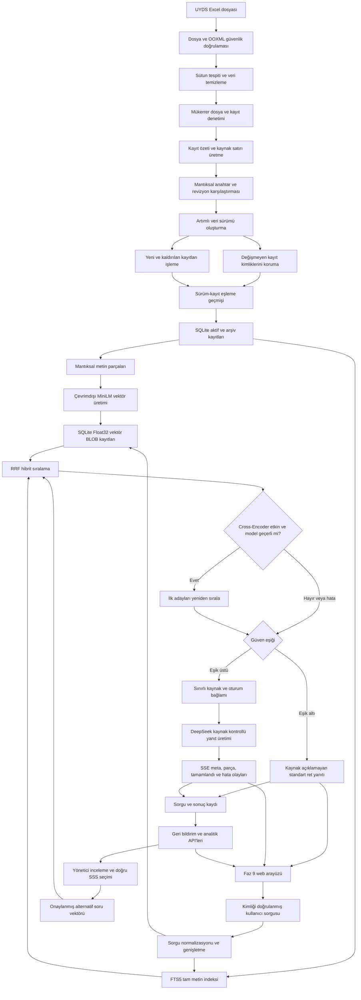

# UYDS Akıllı SSS Destek Asistanı

[](https://github.com/mecik-arda/UYDS-SSS-hades-bot/actions/workflows/faz1-10-dogrulama.yml)
[](https://github.com/mecik-arda/UYDS-SSS-hades-bot/actions/workflows/codeql.yml)

Sürüm 1.0.0 | Faz 1-12 tamamlandı | Geliştirme sürümü | MIT Lisansı

## Proje Durumu

HadesBot, UYDS Sık Sorulan Sorular verilerini güvenli biçimde hazırlayan, anlamsal olarak aranabilir hale getiren ve kaynak kontrollü yanıt üreten kurumsal bir destek asistanı olarak geliştirilmektedir.

Mevcut sürüm; güvenli uygulama altyapısını, SQLite ve FTS5 veri katmanını, Excel içe aktarımını, veri sürümlemeyi, metin parçalamayı, yerel anlamsal vektör üretimini, sorgu genişletmeyi, RRF tabanlı hibrit aramayı, güvenli ve isteğe bağlı Cross-Encoder yeniden sıralama katmanını, kaynak kontrollü DeepSeek istemcisini, güven eşiği kapısını, SSE olay üretimini, kullanıcıya bağlı oturum hafızasını, kimlik doğrulamalı API rotalarını, yönetici onaylı alternatif soru öğrenme döngüsünü, responsive kurumsal web arayüzünü, PII maskeleme ve veri saklama süresi temizliğini (Faz 12) içerir. Cross-Encoder varsayılan olarak kapalıdır; üretimde etkinleştirilmesi Faz 10 Türkçe retrieval benchmarkı ve kaynak ölçümü sonucuna bağlıdır.

| Faz | Kapsam | Durum |
|---|---|---|
| Faz 1 | Ortam, Docker, yapılandırma ve güvenlik altyapısı | Tamamlandı |
| Faz 2 | SQLite, FTS5, veri modelleri ve şifreleme | Tamamlandı |
| Faz 3 | Excel aktarımı, sürümleme ve metin parçalama | Tamamlandı |
| Faz 4 | Vektör gömmeleri ve kurum içi terim haritası | Tamamlandı |
| Faz 5 | Sorgu genişletme, hibrit arama, RRF ve güvenli Cross-Encoder katmanı | Tamamlandı; Cross-Encoder üretim aktivasyonu benchmark bekliyor |
| Faz 6 | DeepSeek, kaynak kontrollü RAG, SSE ve oturum hafızası | Tamamlandı; canlı bağlantı sentetik ve kurum onaylı gerçek kaynaklarla doğrulandı |
| Faz 7 | API rotaları, kimlik doğrulama ve merkezi hata yönetimi | Tamamlandı |
| Faz 8 | Alternatif soru öğrenme döngüsü ve genişletilmiş analitik iş akışı | Tamamlandı |
| Faz 9 | Kurumsal web arayüzü | Tamamlandı |
| Faz 10 | Benchmark, kabul ölçümleri ve geniş güvenlik doğrulaması | Tamamlandı; Yargu ve Yggdrasil ile 25/25 benchmark ve 119/119 sızma testi başarıyla geçildi |
| Faz 11 | Veri Ambarı ve Çoklu Veri Kaynağı Entegrasyonu (Gelecek Vizyonu) | Mimari tasarım dokümanı hazır; detaylar için `FAZ11_MIMARI_VIZYON.md` |
| Faz 12 | Veri Gizliliği ve Analitik Kayıt Yönetimi | Tamamlandı; PII maskeleme, otomatik veri temizliği, yönetici gizlilik kontrolü |
| Faz 13 | Gelişmiş Kurumsal Yetenekler ve Hata Toleransı | Planlandı |

## Veri Gizliliği

UYDS Excel dosyaları, soru-cevap içerikleri, SQLite veritabanları, vektör kayıtları, günlükler, yedekler ve proje çıktıları özel kurumsal veridir. Bu dosyalar GitHub, kişisel bulut depolama, e-posta veya harici dosya paylaşım servislerine aktarılmamalıdır.

`veriler/`, `yedekler/` ve `modeller/` dizinleri sürüm kontrolünden çıkarılmıştır. Kurum içi terim haritasının gerçek içeriği de yalnızca `veriler/es_anlamlilar.json` dosyasında yerel olarak tutulur. Depodaki `es_anlamlilar.example.json` sadece kurumsal veri içermeyen bir şablondur. Gerçek veri yalnızca yetkili yerel çalışma ortamında tutulmalıdır. UYDS metinleri vektör üretimi sırasında dış servislere gönderilmez.

Faz 6 canlı yanıt üretimi etkinleştirildiğinde yalnızca güven eşiğini geçen ilk kaynak parçaları, kullanıcı sorusu ve sınırlı oturum geçmişi yapılandırılmış DeepSeek API adresine gönderilir. Üretim profilinde hedef alan adı ayrıca `DEEPSEEK_IZINLI_ALAN_ADLARI` listesinde bulunmak zorundadır. Bu özellik kurumun veri işleme ve dış servis politikası onaylanmadan etkinleştirilmemelidir. `DEEPSEEK_API_ANAHTARI` boş bırakıldığında dış çağrı yapılamaz; düşük güvenli sorularda anahtar bulunsa bile DeepSeek çağrısı yapılmaz ve kaynak kimlikleri istemciye açıklanmaz.

Şifreli veritabanı yalnızca oluşturulurken kullanılan `VERITABANI_SIFRELEME_ANAHTARI` ile açılabilir. Mevcut bir `.db.enc` dosyası varken yeni anahtar üretmek veriyi kurtarmaz. Anahtar değişikliği veya veritabanı yeniden oluşturma öncesinde `.env`, `.db.enc`, kaynak Excel ve kurum içi terim haritası birlikte erişimi kısıtlı yerel bir kurtarma yedeğine alınmalıdır. `yedekler/` altında tutulan kurtarma kopyaları sır ve kurumsal veri içerir; Git'e eklenmemeli veya paylaşılmamalıdır.

## Tamamlanan Özellikler

### Uygulama ve güvenlik altyapısı

- FastAPI uygulama yaşam döngüsü ve sağlık kontrolü
- Ortam profilleri: `dev`, `test`, `prod`
- Zorunlu ve doğrulanan JWT, veritabanı şifreleme ve yönetici parolası değerleri
- Yapılandırılabilir istek sınırı ve akış tabanlı istek gövdesi boyut kontrolü
- Yinelenen `Content-Length` ve `Content-Length`/`Transfer-Encoding` çakışmasını uygulamaya ulaşmadan reddeden HTTP istek çerçeveleme koruması
- Güvenlik başlıkları ve sınırlı CORS politikası
- SQLite üzerinde merkezi kullanıcı ve IP brute-force sayaçları
- bcrypt tabanlı parola özetleme
- JWT oluşturma, çözme ve RBAC bağımlılık altyapısı
- Hassas değer maskeleyen yapılandırılmış günlükleme
- Non-root Docker kullanıcısı, salt-okunur kök dosya sistemi, capability kaldırma ve `no-new-privileges`
- Salt-okunur model bağlama noktası ve yalnızca veri dizininde kalıcı yazma yetkisi
- Haftalık Python, Docker ve GitHub Actions bağımlılık güncellemeleri ile yapılandırma doğrulaması için geçerli Dependabot politikası
- Her push ve pull request için güncel pytest paketi, Ruff, Bandit, `pip check`, `pip-audit`, sır kalıbı, gerçek Chromium E2E ve Docker sağlık duman testi çalıştıran GitHub Actions iş akışı
- Python ve JavaScript kaynaklarını `security-extended` sorgularıyla tarayan CodeQL güvenlik analizi
- Güvenlik düzeltmeleri güncel bağımlılıklar, CPU odaklı PyTorch ve PyJWT ile sınırlandırılmış çalışma zamanı
- Ayrı liveness ve veritabanı/FTS readiness kontrolleri
- PID sınırı ve kontrollü kapanış süresi

### Veritabanı altyapısı

- Bağlantı başına SQLite yönetimi
- WAL, foreign key ve busy timeout ayarları
- 15 normal tablo ve bir FTS5 sanal tablosu
- INSERT, UPDATE ve DELETE işlemlerinde FTS5 eşitleme tetikleyicileri
- Tek seferlik ve kayıtlı şema migrasyonları
- Durum, puan ve boolean alanları için veritabanı doğrulama kısıtları
- Arama, sürüm, parça, vektör ve oturum sorgularına uygun indeksler
- Veri sürümleri ile SSS kayıtlarını, kaynak sayfa ve satır anlık görüntüsüyle eşleyen kalıcı ilişki tablosu
- AES-256-GCM ile doğrulanmış veritabanı şifreleme
- PBKDF2-HMAC-SHA256 anahtar türetme
- Bağlantı ömrü boyunca paylaşımlı, şifreleme sırasında özel süreçler arası dosya kilidi
- Temiz kapanışta WAL checkpoint, bütünlük kontrolü ve düz metin temizliği
- Atomik yedekleme, geri yükleme, saklama sınırı ve zamanlama

### Excel veri aktarımı

- Standart `Kategori`, `Soru`, `Cevap`, `Kaynak Doküman` şeması
- Mevcut kurumsal UYDS Excel şeması
- İlk 25 satır içinde dinamik başlık tespiti
- Dosya boyutu, MIME, OOXML imzası ve içerik türü doğrulaması
- ZIP path traversal, sıkıştırma bombası, makro, OLE, ActiveX ve harici bağlantı denetimi
- Formül ve formül enjeksiyonu reddi
- SHA-256 ile aynı dosyanın yeniden aktarılmasını engelleme
- Dosya içindeki birebir mükerrer kayıtları eleme
- Excel çalışma sayfası, satır numarası ve kayıt özeti izlenebilirliği
- Değişmeyen kayıt kimliklerini ve parçalarını koruyan artımlı sürümleme
- Tekil mantıksal anahtarlarda önceki kayıt bağlantısı ve alan bazlı revizyon geçmişi
- Yeni kayıtta 1 ile başlayan ve her içerik revizyonunda bağımsız artan içerik sürümü
- Yalnızca kaldırılan veya değişen kayıtları arşivleme
- Süreçler arası `BEGIN IMMEDIATE` aktarım kilidi ve benzersiz dosya özeti
- Veri yazmadan eklenen, güncellenen, korunan ve kaldırılan kayıtları raporlayan kuru çalışma
- Geçmiş veri üyeliğini yeni ve denetlenebilir bir sürüm olarak etkinleştiren geri alma
- Denetim günlüğü ve veri sürümü geçmişi
- Paragraf, satır ve cümle sınırlarını koruyan metin parçalama

### Yerel anlamsal vektörler

- Olay öncesi sabit committen indirilen `paraphrase-multilingual-MiniLM-L12-v2`
- Yalnızca JSON, tokenizer ve `safetensors` dosyalarına izin veren model allowlist’i
- Resmî LFS SHA-256, dosya boyutu, yerel manifest ve model mimarisi doğrulaması
- Normal çalışma sırasında zorunlu çevrimdışı model yükleme
- Her aktif metin parçası için normalize edilmiş 384 boyutlu Float32 vektör
- Metin SHA-256 özetiyle yalnızca yeni veya değişen parçaları işleyen artımlı üretim
- Pasif SSS kayıtlarına ait vektörlerin temizlenmesi
- BLOB uzunluğu, vektör boyutu ve parça-model benzersizliği için veritabanı koruması
- Doğrulanan kurum içi terim ve eş anlamlı haritası

### Hibrit arama

- Türkçe sorgu normalizasyonu ve kurum içi eş anlamlılarla sorgu genişletme
- SQLite FTS5 BM25 ile yapılandırılabilir kelime arama adayları
- Yerel vektörler üzerinde kosinüs benzerliği ve SSS düzeyinde parça gruplama
- FTS ve vektör sıralarını Reciprocal Rank Fusion ile birleştirme
- Kaynak doküman, sayfa, satır ve aday metni taşıyan arama sonuçları
- Sabit revizyonlu `mmarco-mMiniLMv2-L12-H384-v1` için isteğe bağlı Cross-Encoder yeniden sıralayıcı
- Yalnızca ilk yapılandırılabilir aday grubunu skorlayan ve kalan RRF sırasını koruyan sınırlı yürütme
- İzinli dosya listesi, resmî `safetensors` SHA-256, yerel manifest, mimari ve tokenizer doğrulaması
- Uzaktan kodu ve ağ erişimini kapatan yerel model yükleme; model hatasında RRF sırasına güvenli dönüş
- Yapılandırılabilir FTS alan ağırlıkları ve sonuç başına sorgu genişletme teşhisleri
- Gerçek kosinüs benzerliğini RRF sırasından bağımsız taşıyan güven skoru girdisi

### Kaynak kontrollü yanıt üretimi

- Yapılandırılabilir HTTPS DeepSeek Chat Completions istemcisi ve yerel geliştirme adresi desteği
- Üretim profilinde DeepSeek hedef alan adı izin listesi; URL kimlik bilgisi, sorgu ve parça reddi
- Yalnızca geçici ağ ve servis hatalarında, ilk çıktı parçasından önce üstel yeniden deneme
- Kaynak metnindeki talimatları veri kabul eden ve dış bilgi kullanımını yasaklayan sistem istemi
- İlk kaynak sayısını ve kaynak başına karakter sayısını sınırlayan bağlam bütçesi
- Toplam akış süresi ve biriktirilen yanıt karakteri için uygulama tarafı kaynak sınırları
- Gerçek vektör kosinüs benzerliğine dayalı `GUVEN_ESIGI` kapısı
- `0.0` ile `1.0` arasında doğrulanan güven eşiği
- Eşik altındaki ve yalnızca FTS ile bulunan sorularda dış API çağrısı ve kaynak özeti üretmeden standart ret yanıtı
- JSON kodlamalı `meta`, `parca`, `tamamlandi` ve `hata` SSE olayları
- Satır enjeksiyonuna dayanıklı SSE veri çerçeveleme
- TTL, mesaj sayısı ve toplam oturum sayısı sınırlı bellek içi konuşma hafızası
- API anahtarı veya sağlayıcı hata ayrıntısını kullanıcı akışına taşımayan hata yönetimi
- Sentetik verilerle çalışan toplam 119 birim, sözleşme, güvenlik, servis entegrasyon ve ön yüz sunum testi

### Faz 7 API ve kimlik güvenliği

- JWT `kid`, yayıncı, hedef, `jti`, erişim türü ve zorunlu claim doğrulaması
- Özetlenmiş opaque refresh token, her yenilemede rotasyon ve tekrar kullanımda token ailesi iptali
- Çıkışta erişim belirteci karalisteleme, refresh ailesi iptali ve kullanıcı oturumlarını temizleme
- Sunucunun ürettiği tahmin edilemez oturum kimliğini kullanıcı hesabına bağlama
- Kullanıcılar arasında oturum okuma ve yazma yalıtımı
- Kimlik doğrulamalı SSE arama, günlük kullanıcı kotası ve eşzamanlı akış sınırı
- Geri bildirim, SSS listeleme, yönetici onayı, yeniden indeksleme ve analitik rotaları
- Kritik yönetici işlemlerinde zaman damgası, nonce ve gövde özeti içeren HMAC imzası
- Tekrar kullanılan yönetici nonce değerlerini SQLite üzerinde reddetme
- Girdi değerlerini geri yansıtmayan merkezi doğrulama ve hata yanıtları
- Her yanıtta izlenebilir ancak tahmin edilemez istek kimliği
- Salt okunur `/run/secrets` bağlama noktası üzerinden yeniden başlatmasız DeepSeek anahtar rotasyonu
- Süresi dolan refresh ailelerini, erişim karalistesini ve yönetici nonce kayıtlarını başlangıçta ve yapılandırılabilir aralıklarla temizleyen güvenlik bakımı
- Bellek içi oturum sahipliğini korumak için standart dağıtımda çoklu worker yapılandırmasını başlangıçta reddetme
- Faz 7 rotalarını ve kritik yönetici HMAC başlıklarını koruyan OpenAPI sözleşme testleri

### Faz 8 geri bildirim ve alternatif soru öğrenme döngüsü

- Kullanıcı puanı, yorumu, dönen cevap, ilk kaynak SSS kimliği ve önerilen doğru SSS kimliğini `BEKLEMEDE` durumunda kaydetme
- Yöneticinin kullanıcının seçimini koruyabilmesi veya aktif başka bir SSS kaydıyla değiştirebilmesi
- Yönetici onayında kullanıcı sorusunu doğrudan `onaylandi` durumundaki alternatif soru olarak etkinleştirme
- Alternatif soru vektörlerinde model kimliği, vektör boyutu ve metin özeti bütünlük bilgilerini saklama
- Model değişiminde onaylanmış alternatif soru vektörlerini yeniden üretme
- Alternatif soru benzerliğini yapılandırılabilir eşik ve aday sınırıyla filtreleme
- Alternatif soru sırasını RRF skoruna dönüştürerek FTS ve ana vektör sonuçlarıyla tekilleştirilmiş biçimde birleştirme
- Eski veritabanlarına geri bildirim ve alternatif soru metadata sütunlarını geriye uyumlu biçimde ekleme
- Cevapsız veya güven eşiği altındaki sorguları yönetici yetkisiyle sayfalı olarak listeleme

### Faz 9 kurumsal web arayüzü

- `/`, `/yonetici` ve `/analitik` rotalarında Jinja2 tabanlı açık kurşuni çalışma alanı ve koyu lacivert navigasyon
- Responsive sol navigasyon, kullanıcı profili, sistem hazırlık bandı, yerel soru geçmişi ve görünüm ayarları
- JWT giriş, yenileme ve çıkış yaşam döngüsünü API ile yöneten tarayıcı istemcisi
- `fetch` akışıyla SSE olaylarını parça parça işleyen canlı sohbet, güven göstergesi ve kaynak rozetleri
- Yönetici yetkisini API rolüyle doğrulayan geri bildirim ve cevapsız sorgu panelleri
- Analitik özet kartları, kategori çubuk grafiği ve cevapsız soru listesi
- Sunucu içeriğini yalnızca güvenli DOM `textContent` işlemleriyle gösteren, satır içi betik kullanmayan XSS dayanıklı çıktı üretimi
- Klavye odağı, atlama bağlantısı, semantik bölgeler, azaltılmış hareket desteği ve 390 piksel mobil kırılım doğrulaması

## Mevcut Veri Akışı



Gerçek UYDS çalışma kitabında 2.399 veri satırı okunmuş, birebir mükerrer bir satır elendikten sonra 2.398 benzersiz kayıt ve 4.075 metin parçası oluşturulmuştur. Gerçek içerikler ve üretilen veritabanı sürüm kontrolüne dahil edilmez.

## Planlanan Özellikler

- Türkçe retrieval benchmarkı sonrasında Cross-Encoder üretim aktivasyonu ve aday sayısı ayarı
- Temsili retrieval benchmarkı, penetrasyon senaryoları ve başarı ölçümleri
- **Yapay Zeka ve Prompt Optimizasyonu (Faz 11):** Sistem talimatı iyileştirmesi, Reranker devreye alımı, Few-Shot Prompting ve sentetik veri temizliği.
- **Veri Gizliliği ve Analitik (Faz 12):** Otomatik log temizleme (Data Retention), hassas veri anonimleştirme (PII Masking) ve yönetici için kişisel verileri dışlama özelliği.
- **Gelişmiş Kurumsal Yetenekler (Faz 13):** Arama sonuçlarında rol bazlı filtreleme (RBAC for Retrieval), çevrimdışı yedekleme modu (Offline Fallback) ve işleme dönük butonlar (Intent Deep-Linking).

## Son İyileştirmeler (Hotfix & İnce Ayarlar)
- TensorFlow ve Keras 3 uyumluluk sorunlarını gidermek için `tf-keras` ve `protobuf` bağımlılıkları ortamda güncellendi.
- Geçerli ancak kısa soruların reddedilmesini önlemek amacıyla `GUVEN_ESIGI` (Kosinüs Benzerliği) değeri `0.70` seviyesinden `0.50` seviyesine optimize edildi ve bu değişiklik `hata_duzeltme_kaydi.md` kütüğüne işlendi.

## Teknoloji Yığını

| Bileşen | Teknoloji | Kullanım durumu |
|---|---|---|
| Programlama dili | Python 3.11 | Aktif |
| Web çatısı | FastAPI | Aktif |
| ASGI sunucusu | Uvicorn | Aktif |
| Veritabanı | SQLite3 ve FTS5 | Aktif |
| Veri işleme | Pandas ve OpenPyXL | Aktif |
| Veri doğrulama | Pydantic ve Pydantic-Settings | Aktif |
| Şifreleme | cryptography, AES-256-GCM | Aktif |
| Parola güvenliği | bcrypt | Aktif |
| İstek sınırlama | SlowAPI | Aktif |
| Konteyner | Docker ve Docker Compose | Aktif |
| Vektör gömmeleri | Sentence-Transformers ve NumPy | Aktif |
| Yeniden sıralama | Sentence-Transformers Cross-Encoder | Güvenli yerel entegrasyon hazır; üretim aktivasyonu benchmark bekliyor |
| LLM istemcisi | HTTPX ve DeepSeek Chat Completions API | Aktif; sentetik ve kurum onaylı gerçek kaynaklarla canlı bağlantı doğrulandı |
| Web arayüzü | Jinja2, HTML, CSS ve JavaScript | Aktif |

## Ön Koşullar

Docker ile çalıştırma:

- Docker Engine 20.10 veya üzeri
- Docker Compose V2

Yerel çalıştırma:

- Python 3.11
- Proje bağımlılıkları için izole sanal ortam

DeepSeek API anahtarı uygulamanın başlaması, yerel arama ve düşük güvenli soru reddi için gerekli değildir. Güven eşiğini geçen bir soruda canlı kaynak kontrollü yanıt üretmek için kurum tarafından onaylanmış bir anahtar zorunludur.

## Kurulum

Depoyu klonlayın:

```text
git clone https://github.com/mecik-arda/UYDS-SSS-hades-bot.git
cd UYDS-SSS-hades-bot
```

Ortam dosyasını ve yerel terim haritasını oluşturun:

```text
copy .env.example .env
if not exist veriler mkdir veriler
copy es_anlamlilar.example.json veriler\es_anlamlilar.json
```

Linux veya macOS:

```text
cp .env.example .env
mkdir -p veriler
cp es_anlamlilar.example.json veriler/es_anlamlilar.json
```

`.env` içinde en az şu üç değeri güçlü ve benzersiz değerlerle değiştirin:

- `VERITABANI_SIFRELEME_ANAHTARI`
- `JWT_GIZLI_ANAHTARI`
- `VARSAYILAN_YONETICI_SIFRESI`

DeepSeek anahtarı doğrudan ortam değişkeni yerine salt okunur dosyadan verilecekse anahtarı Git tarafından dışlanan `sirlar/` dizininde tutun, `DEEPSEEK_API_ANAHTAR_DOSYASI=/run/secrets/deepseek_api_anahtari` değerini ayarlayın ve `DEEPSEEK_API_ANAHTARI` değerini boş bırakın. Docker Compose, `sirlar/` dizinini konteynere `/run/secrets` konumunda salt okunur bağlar. Anahtar dosyası sembolik bağlantı olamaz ve 4096 baytı aşamaz.

Orijinal çalışma kitabını aşağıdaki konuma yerleştirin:

```text
veriler/UYDS_SSS_Listesi.xlsx
```

Gerçek Excel dosyasını Git’e eklemeyin.

`veriler/es_anlamlilar.json` içeriğini yalnızca yetkili yerel ortamda kurum terimleriyle düzenleyin. Uygulama bu dosya eksikse örnek veya varsayılan kurumsal içerik kullanmaz ve açık hata verir.

## Yapılandırma

| Değişken | Açıklama | Varsayılan |
|---|---|---|
| `ORTAM_PROFILI` | Etkin ortam profili | `prod` |
| `DEEPSEEK_API_ANAHTARI` | Canlı DeepSeek yanıtı için kurum onaylı anahtar | Boş |
| `DEEPSEEK_API_ANAHTAR_DOSYASI` | Yeniden başlatmasız rotasyon için salt okunur anahtar dosyası | Boş |
| `DEEPSEEK_API_ADRESI` | HTTPS Chat Completions uç noktası | `https://api.deepseek.com/chat/completions` |
| `DEEPSEEK_MODEL_ADI` | Kullanılacak DeepSeek model kimliği | `deepseek-v4-pro` |
| `DEEPSEEK_ZAMAN_ASIMI_SANIYE` | Dış API istek zaman aşımı | `120` |
| `DEEPSEEK_YENIDEN_DENEME_SAYISI` | Geçici hata sonrası ek deneme sayısı | `2` |
| `DEEPSEEK_YENIDEN_DENEME_TABAN_SANIYE` | Üstel beklemenin başlangıç süresi | `0.5` |
| `DEEPSEEK_KAYNAK_SAYISI` | Yanıt üretimine gönderilecek azami kaynak | `5` |
| `DEEPSEEK_KAYNAK_MAKS_KARAKTER` | Kaynak başına bağlam karakter sınırı | `6000` |
| `DEEPSEEK_IZINLI_ALAN_ADLARI` | Üretimde kullanılabilecek virgülle ayrılmış API alan adları | `api.deepseek.com` |
| `DEEPSEEK_YANIT_MAKS_KARAKTER` | Tek yanıtta alınabilecek azami toplam karakter | `32768` |
| `DEEPSEEK_AKIS_MAKS_SANIYE` | Tek canlı akışın azami toplam süresi | `180` |
| `VERITABANI_YOLU` | SQLite dosya yolu | `veriler/veri_deposu.db` |
| `VERITABANI_SIFRELEME_ANAHTARI` | En az 32 karakterli şifreleme anahtarı | Zorunlu |
| `GUVEN_ESIGI` | DeepSeek çağrısı için `0.0`–`1.0` arası asgari kosinüs benzerliği | `0.70` |
| `VEKTOR_MODEL_ADI` | Veritabanında saklanan model kimliği | `paraphrase-multilingual-MiniLM-L12-v2` |
| `VEKTOR_MODEL_YOLU` | Doğrulanmış yerel model dizini | `modeller/paraphrase-multilingual-MiniLM-L12-v2` |
| `VEKTOR_BOYUTU` | Beklenen embedding boyutu | `384` |
| `VEKTOR_TOPLU_ISLEM_BOYUTU` | Tek model çağrısında işlenen parça sayısı | `32` |
| `ES_ANLAMLILAR_YOLU` | Kuruma özel terim haritası | `veriler/es_anlamlilar.json` |
| `JWT_GIZLI_ANAHTARI` | En az 32 karakterli JWT anahtarı | Zorunlu |
| `JWT_ALGORITMASI` | JWT imza algoritması | `HS256` |
| `JWT_OMRU_DAKIKA` | Erişim belirteci ömrü | `30` |
| `JWT_YENILEME_OMRU_GUN` | Yenileme belirteci ömrü | `7` |
| `JWT_ANAHTAR_KIMLIGI` | Etkin JWT imza anahtarı kimliği | `ana-1` |
| `JWT_ONCEKI_GIZLI_ANAHTAR` | Rotasyon sırasında doğrulanacak önceki JWT anahtarı | Boş |
| `JWT_ONCEKI_ANAHTAR_KIMLIGI` | Önceki JWT anahtarı kimliği | Boş |
| `YONETICI_ISTEK_IMZA_ANAHTARI` | Kritik yönetici isteklerinin HMAC anahtarı; boşsa JWT anahtarı kullanılır | Boş |
| `YONETICI_IMZA_ZAMAN_PENCERESI_SANIYE` | Yönetici imzası zaman toleransı | `300` |
| `VARSAYILAN_YONETICI_SIFRESI` | En az 12 karakterli yönetici parolası | Zorunlu |
| `ISTEK_SINIRI` | Pencere başına istek sayısı | `100` |
| `ISTEK_PENCERESI_SANIYE` | İstek sınırı penceresi | `60` |
| `UYGULAMA_PORT` | Dış HTTP portu | `8000` |
| `MESAJ_MAKS_KARAKTER` | Kullanıcı mesajı karakter sınırı | `2000` |
| `DEEPSEEK_MAKS_TOKEN` | LLM çıktı token sınırı | `4096` |
| `GUNLUK_MESAJ_KOTASI` | Kullanıcı başına günlük arama kotası | `500` |
| `OTURUM_MAKS_MESAJ` | Oturum başına saklanan mesaj sınırı | `50` |
| `OTURUM_TTL_DAKIKA` | Hareketsiz oturum yaşam süresi | `30` |
| `OTURUM_MAKS_SAYI` | Bellekte tutulacak toplam oturum sınırı | `1000` |
| `ESZAMANLI_AKIS_MAKS_SAYI` | Aynı anda işlenebilecek SSE akış sayısı | `10` |
| `UYGULAMA_WORKER_SAYISI` | Bellek içi oturum sahipliği için zorunlu worker sayısı | `1` |
| `GUVENLIK_BAKIM_ARALIGI_SAAT` | Süresi dolmuş güvenlik kayıtlarının bakım aralığı | `6` |
| `ISTEK_GOVDE_MAKS_BOYUT` | Genel istek gövdesi sınırı | `1048576` |
| `DOSYA_YUKLEME_MAKS_BOYUT` | Excel yükleme sınırı | `52428800` |
| `LOG_SEVIYESI` | Günlük seviyesi | `INFO` |
| `RRF_K` | Reciprocal Rank Fusion sabiti | `60` |
| `FTS_ADAY_SAYISI` | FTS5 tarafından alınacak azami aday | `50` |
| `VEKTOR_ADAY_SAYISI` | Vektör aramasından alınacak azami aday | `50` |
| `RRF_ADAY_SAYISI` | Harmanlama sonrasında korunacak azami aday | `20` |
| `ALTERNATIF_SORU_ADAY_SAYISI` | Alternatif soru kanalından alınacak azami aday | `5` |
| `ALTERNATIF_SORU_BENZERLIK_ESIGI` | Alternatif sorunun RRF birleştirmesine katılacağı en düşük kosinüs benzerliği | `0.70` |
| `YENIDEN_SIRALAMA_ETKIN` | Cross-Encoder yeniden sıralamayı etkinleştirir | `false` |
| `YENIDEN_SIRALAMA_MODEL_YOLU` | Doğrulanmış yerel Cross-Encoder model dizini | `modeller/mmarco-mMiniLMv2-L12-H384-v1` |
| `YENIDEN_SIRALAMA_ADAY_SAYISI` | Cross-Encoder ile skorlanacak ilk RRF adayı sayısı | `10` |
| `YENIDEN_SIRALAMA_TOPLU_ISLEM_BOYUTU` | Tek Cross-Encoder çağrısındaki sorgu-aday çifti sayısı | `8` |
| `YENIDEN_SIRALAMA_MAKS_TOKEN` | Cross-Encoder sorgu-aday çifti token sınırı | `512` |
| `FTS_SORU_AGIRLIGI` | BM25 soru alanı ağırlığı | `1.0` |
| `FTS_CEVAP_AGIRLIGI` | BM25 cevap alanı ağırlığı | `1.0` |
| `FTS_KATEGORI_AGIRLIGI` | BM25 kategori alanı ağırlığı | `1.0` |
| `FTS_HARICI_KOD_AGIRLIGI` | BM25 harici kod alanı ağırlığı | `1.0` |
| `FTS_MODUL_AGIRLIGI` | BM25 modül alanı ağırlığı | `1.0` |
| `FTS_ARAMA_METNI_AGIRLIGI` | BM25 birleşik arama metni ağırlığı | `1.0` |
| `MAKSIMUM_YEDEK_SAYISI` | Saklanacak yedek sayısı | `10` |
| `YEDEKLEME_ARALIGI_SAAT` | Zamanlanmış yedek aralığı | `24` |

Tablodaki değerler uygulama ve Docker Compose varsayılanlarını gösterir. Geliştirme için sunulan `.env.example`, `ORTAM_PROFILI=dev` ve `LOG_SEVIYESI=DEBUG` değerleriyle bu iki varsayılanı bilinçli olarak geçersiz kılar.

`.env.dev`, `.env.test` ve `.env.prod` dosyaları uygulamanın otomatik yüklediği, Git tarafından takip edilen ve yalnızca gizli olmayan profil değerlerini taşıyan dosyalardır; bu dosyalara hiçbir zaman API anahtarı, parola veya şifreleme anahtarı yazılmamalıdır. Gizli değerler Git dışında tutulan `.env`, salt okunur `sirlar/` dosyaları veya kurumun yetkili secret sağlayıcısı üzerinden verilmelidir. `.env` ignore edilirken `.env.example` güvenli kurulum şablonu olarak sürüm kontrolünde tutulur.

Her yapılandırma anahtarı `.env` içinde yalnızca bir kez tanımlanmalıdır. Özellikle `ORTAM_PROFILI`, `VERITABANI_YOLU` ve `VERITABANI_SIFRELEME_ANAHTARI` için yinelenen tanımlar profil dosyalarının beklenmeyen sırayla uygulanmasına veya yanlış şifreli veritabanının seçilmesine neden olabilir. Mevcut şifreli veritabanı taşınırken standart yol `veriler/veri_deposu.db` olarak korunmalı ve aynı şifreleme anahtarı kullanılmalıdır.

## Excel Verilerini İçe Aktarma

İçe aktarım sırasında uygulama kapalı olmalıdır.

Yerel Python ortamında varsayılan dosyayı aktarın:

```text
python excel_ice_aktar.py
```

Başka bir `.xlsx` dosyasını aktarın:

```text
python excel_ice_aktar.py veriler/yeni_sss_surumu.xlsx
```

Veritabanındaki aktif veriyi değiştirmeden aktarım farklarını inceleyin:

```text
python excel_ice_aktar.py veriler/yeni_sss_surumu.xlsx --kuru-calistir
```

Geçmiş bir veri sürümünü yeni ve denetlenebilir bir sürüm olarak etkinleştirin:

```text
python excel_ice_aktar.py --surum-geri-al 3
```

Daha önce aktarılmış ancak artık arşivlenmiş bir Excel dosyası yeniden verilirse aktarım açık bir hatayla durur. Aynı veriyi yeniden etkinleştirmek için dosyayı tekrar yüklemek yerine ilgili sürüm numarasıyla `--surum-geri-al` kullanılmalıdır.

Docker ile aktarım:

```text
docker compose build
docker compose run --rm uyds_sohbet_botu_uygulamasi python excel_ice_aktar.py
```

Komut JSON biçiminde şu alanları döndürür:

- `surum_numarasi`
- `aktarilan_kayit_sayisi`
- `olusturulan_parca_sayisi`
- `arsivlenen_kayit_sayisi`
- `eklenen_kayit_sayisi`
- `guncellenen_kayit_sayisi`
- `korunan_kayit_sayisi`
- `yinelenen_dosya`
- `dosya_ozeti`

Kuru çalışma çıktısı toplam, eklenen, güncellenen, korunan ve arşivlenen kayıt sayılarını; dosyanın daha önce görülüp görülmediğini ve SHA-256 özetini döndürür. Geri alma çıktısı hedef ve yeni sürüm numaralarıyla etkinleştirilen, korunan ve arşivlenen kayıt sayılarını döndürür.

Aktarım tamamlandığında düz metin SQLite dosyası AES-256-GCM ile şifrelenir.

## Yerel Vektör Modeli ve Embedding Üretimi

Model hazırlama işlemi yalnızca genel model dosyalarını indirir; UYDS verisini okumaz veya dışarı göndermez. İndirme aracı model kimliğini ve olay öncesi revizyonu sabit tutar, yalnızca izinli dosyaları alır ve resmî LFS SHA-256 değerlerini doğrular:

```text
python vektor_modelini_hazirla.py
```

Model hazırlandıktan sonra aktif SSS parçalarının vektörlerini üretin:

```text
python vektorleri_olustur.py
```

Vektör durumunu modeli belleğe yüklemeden inceleyin:

```text
python vektorleri_olustur.py --durum
```

Seçili modele ait bütün aktif vektörleri yeniden üretin:

```text
python vektorleri_olustur.py --tumunu-yenile
```

Tam yenileme mevcut aktif vektörleri önceden silmez. Model yükleme veya üretim hatasında tamamlanmamış kayıtlar önceki geçerli vektörlerini korur; yalnızca başarıyla üretilen toplu işlemler atomik olarak güncellenir.

Docker kullanırken model hazırlama işlemi ana makinede bir kez yapılır. `modeller/` dizini uygulama konteynerine salt-okunur bağlanır. Normal vektör üretimi `HF_HUB_OFFLINE`, `TRANSFORMERS_OFFLINE` ve `HF_DATASETS_OFFLINE` değerlerini zorunlu olarak etkinleştirir.

Model ve vektör komutlarını proje sanal ortamında veya Docker imajında çalıştırmak önerilir. Paylaşımlı bir Python ortamındaki ilgisiz TensorFlow/protobuf paketleri `transformers` yüklemesini bozarsa temiz proje ortamı kullanılmalıdır. Yalnızca PyTorch tabanlı tek seferlik yerel üretimde `USE_TF=0` ve `TRANSFORMERS_NO_TF=1` ortam değişkenleriyle TensorFlow entegrasyonu kapatılabilir; bu değerler üretim yapılandırmasının zorunlu parçası değildir.

## Yerel Cross-Encoder Yeniden Sıralama

Cross-Encoder varsayılan olarak kapalıdır. Sabit revizyonlu ve SHA-256 doğrulamalı model dosyalarını kurum verisi okumadan yerel dizine hazırlayın:

```text
python yeniden_siralama_modelini_hazirla.py
```

Türkçe retrieval benchmarkı doğruluk, p50/p95 gecikme ve tepe bellek açısından kabul edilebilir sonuç verirse `.env` içinde etkinleştirin:

```text
YENIDEN_SIRALAMA_ETKIN=true
```

Uygulama yalnızca ilk `YENIDEN_SIRALAMA_ADAY_SAYISI` RRF adayını yeniden skorlar. Model bulunamaz, bütünlük denetiminden geçemez veya geçersiz skor üretirse istek başarısız edilmez; özgün RRF sırası korunur ve yeniden sıralamanın uygulanmadığı sonuç teşhisine yazılır. Model yükleme çalışma zamanında çevrimdışıdır, uzaktan model koduna izin verilmez ve pickle ağırlıkları kabul edilmez.

## Uygulamayı Çalıştırma

Docker:

```text
docker compose up --detach --build
```

### Docker Compose servis yapısı

Docker Desktop içindeki `hadesbot` satırı tek başına bir konteyner değildir. Docker Compose tarafından oluşturulan proje grubudur ve aşağıdaki iki bağımsız konteyneri birlikte gösterir:

| Docker Desktop adı | Compose servisi | Görev |
|---|---|---|
| `uyds_asistani` | `uyds_sohbet_botu_uygulamasi` | FastAPI uygulamasını, sağlık kontrollerini, veritabanı işlemlerini ve yerel vektör modelini çalıştırır. Dışarıya `8000` portunu açar. |
| `hadesbot-uyds_yedekleyici-1` | `uyds_yedekleyici` | Yapılandırılan aralıkta veritabanı ve kurum içi terim haritası yedeklerini oluşturur. Dışarıya HTTP portu açmaz. |

İki konteyner aynı `hadesbot-uygulama:yerel` imajından oluşturulur ancak farklı komutlarla ayrı süreçler olarak çalışır. Aynı Compose ağına ve ana makinedeki `veriler/` dizinine bağlanırlar. Uygulama konteyneri ayrıca `modeller/` dizinini salt-okunur bağlar. Docker Desktop’ta `hadesbot` satırının solundaki ok kullanılarak iki konteyner ayrı ayrı görüntülenebilir.

Servislerin durumunu görüntüleme:

```text
docker compose ps
```

Canlı günlükleri izleme:

```text
docker compose logs --follow
```

Konteynerleri Docker Desktop listesinde tutarak durdurma:

```text
docker compose stop
```

Konteynerleri ve Compose ağını kaldırma:

```text
docker compose down
```

`docker compose down` çalışan konteynerleri durdurur ve Docker Desktop listesinden kaldırır. Oluşturulan imajı, proje kaynaklarını ve ana makinedeki `veriler/` ile `modeller/` dizinlerini silmez. `docker compose up --detach` komutu konteynerleri yeniden oluşturup arka planda başlatır.

Yerel Python:

```text
python -m venv .venv
.venv\Scripts\activate
python -m pip install --index-url https://download.pytorch.org/whl/cpu torch==2.13.0+cpu
python -m pip install -r requirements.txt
uvicorn uygulama.ana:uygulama --host 127.0.0.1 --port 8000
```

Linux veya macOS sanal ortam etkinleştirme:

```text
source .venv/bin/activate
```

Mevcut erişim adresleri:

- Sohbet arayüzü: `http://localhost:8000/`
- Yönetici merkezi: `http://localhost:8000/yonetici`
- Analitik görünümü: `http://localhost:8000/analitik`
- Sağlık kontrolü: `http://localhost:8000/api/saglik`
- Hazırlık kontrolü: `http://localhost:8000/api/hazirlik`
- Swagger arayüzü: `http://localhost:8000/docs`
- OpenAPI şeması: `http://localhost:8000/openapi.json`

Web arayüzü açıldığında kimlik doğrulama penceresi gösterilir. Kullanıcı rolü sohbet ekranına; `YONETICI` rolü ayrıca yönetici ve analitik panellerine erişir. Erişim ve yenileme belirteçleri yalnızca geçerli tarayıcı sekmesi oturumunda tutulur.

## API Durumu

### Uygulanan rotalar

| Yöntem | Rota | Açıklama | Yetki |
|---|---|---|---|
| `GET` | `/api/saglik` | Uygulama süreci liveness durumu | Herkese açık |
| `GET` | `/api/hazirlik` | Veritabanı, şema ve FTS5 readiness durumu | Herkese açık |
| `POST` | `/api/v1/kimlik-dogrulama/giris` | Erişim ve yenileme belirteci üretir | Herkese açık |
| `POST` | `/api/v1/kimlik-dogrulama/yenile` | Refresh token rotasyonu yapar | Geçerli refresh token |
| `POST` | `/api/v1/kimlik-dogrulama/cikis` | Token ailesini ve oturumları iptal eder | Kullanıcı |
| `POST` | `/api/v1/arama` | Hibrit arama ve kaynak kontrollü SSE yanıtı | Kullanıcı |
| `GET` | `/api/v1/sss` | Aktif SSS özetlerini sayfalar | Kullanıcı |
| `POST` | `/api/v1/geri-bildirim` | Puan ve yorum kaydeder | Kullanıcı |
| `GET` | `/api/v1/yonetici/geri-bildirimler` | Bekleyen geri bildirimleri listeler | Yönetici |
| `GET` | `/api/v1/yonetici/cevapsiz-sorgular` | Cevapsız veya düşük güvenli sorguları sayfalı listeler | Yönetici |
| `POST` | `/api/v1/yonetici/geri-bildirim/onay` | Geri bildirimi onaylar veya reddeder; yönetici doğru SSS seçimini değiştirebilir | Yönetici ve HMAC |
| `POST` | `/api/v1/yonetici/yeniden-indeksle` | FTS ve vektör indekslerini yeniler | Yönetici ve HMAC |
| `GET` | `/api/v1/analitik` | Kullanım istatistiklerini döndürür | Yönetici |

### Yönetici istek imzası

Kritik yönetici POST isteklerinde geçerli yönetici JWT’sine ek olarak `X-UYDS-Zaman`, `X-UYDS-Nonce` ve `X-UYDS-Imza` başlıkları zorunludur. Zaman değeri Unix saniyesidir. Nonce 32–128 karakter uzunluğunda ve her istek için benzersiz olmalıdır. İmza, aşağıdaki beş değerin satır sonuyla birleştirilmiş UTF-8 metni üzerinde HMAC-SHA256 olarak hesaplanır:

```text
X-UYDS-Zaman
X-UYDS-Nonce
HTTP_YONTEMI
/api/v1/hedef-yol
ISTEK_GOVDESI_SHA256
```

İmza anahtarı `YONETICI_ISTEK_IMZA_ANAHTARI` değeridir; bu değer boşsa `JWT_GIZLI_ANAHTARI` kullanılır. Süresi geçen zaman damgaları reddedilir ve kabul edilen nonce özetleri SQLite üzerinde saklanarak tekrar kullanım `409` yanıtıyla engellenir.

## Yedekleme ve Geri Yükleme

Tek seferlik yedek:

```text
python yedekle.py yedekle
```

Bir yedeği geri yükleme:

```text
python yedekle.py geri-yukle veri_deposu_YYYYMMDD_HHMMSS_ffffff.db
```

Zamanlanmış yedekleme:

```text
python yedekle.py zamanla --aralik-saat 24
```

Her yedek dosyasının yanında `.manifest.json` uzantılı bir bütünlük manifesti oluşturulur. Manifest; SHA-256 dosya özeti, dosya boyutu, UTC oluşturulma zamanı ve düz metin SQLite yedeklerinde aktif kayıt sayısı, FTS5 satır sayısı, veri sürümü ile `quick_check` sonucunu içerir. Geri yükleme öncesinde manifest varsa dosya adı, boyut ve SHA-256 özeti zorunlu olarak doğrulanır. Eski manifestsiz yedekler geriye dönük uyumluluk için kabul edilir.

Docker Compose içindeki `uyds_yedekleyici` servisi zamanlanmış yedeklemeyi otomatik yürütür. Uygulama ve yedekleyici aynı `VERITABANI_YOLU` ile `ES_ANLAMLILAR_YOLU` değerlerini kullanır. Yapılandırılan açık veya şifreli veritabanı bulunamazsa yedekleme başarısız olur; yalnızca terim dosyasını yedekleyip başarılı görünmez. Geri yükleme ve elle Excel aktarımı öncesinde uygulama durdurulmalıdır.

Veritabanı bağlantıları ve yedekleme süreçler arasında paylaşımlı dosya kilidi taşır. Şifreleme, şifre çözme ve geri yükleme işlemleri özel kilit alarak açık SQLite bağlantılarının tamamlanmasını bekler; böylece uygulama ile yedekleyici aynı veri dosyasında yarışmaz.

## Doğrulama

Sözdizimi ve import derlemesi:

```text
python -m compileall -q uygulama excel_ice_aktar.py yedekle.py vektorleri_olustur.py vektor_modelini_hazirla.py yeniden_siralama_modelini_hazirla.py
```

Docker Compose yapılandırması:

```text
docker compose config --quiet
```

Geliştirme bağımlılıklarını ve kalıcı doğrulamaları çalıştırma:

```text
python -m pip install -r requirements-dev.txt
python -m pytest -q
ruff check uygulama testler
bandit -r uygulama -q
python -m pip_audit
```

Faz 3 doğrulamalarında:

- 2.398 benzersiz SSS kaydı aktarıldı.
- 4.075 mantıksal metin parçası oluşturuldu.
- Aktif kayıt ve FTS5 satır sayıları eşleşti.
- Aynı dosyanın ikinci aktarımı yeni sürüm oluşturmadı.
- Kuru çalışma bilgi tabanına veya veri sürümü geçmişine kayıt eklemedi.
- Tek cevap değişikliği 1 revizyon ve 2.397 korunan kayıt olarak sınıflandırıldı.
- Revizyon kaydı önceki SSS kimliği, revizyon numarası ve değişen alanlarla bağlandı.
- Geçmiş veri sürümü yeni bir sürüm olarak geri alındı ve FTS5 üyeliği eşleşti.
- Yedek manifesti, gerçek geri yükleme ve bozuk yedek reddi doğrulandı.
- Eski Faz 2 şeması veri kaybı olmadan yükseltildi.
- Hatalı MIME, makro uzantısı ve formül içeriği reddedildi.
- Parçalı büyük istek gövdesi 413 yanıtıyla reddedildi.
- Merkezi brute-force sayacı süreçler arasında ve eşzamanlı erişimde doğrulandı.
- Şifreli kapanış sonrasında düz metin veritabanı bırakılmadı.

Faz 4 doğrulamalarında:

- Sabit model revizyonu ve üç büyük LFS dosyasının resmî SHA-256 değerleri doğrulandı.
- Model dizininde çalıştırılabilir özel kod, pickle veya güvensiz ağırlık biçimi bulunmadı.
- Windows Defender özel model taraması tehdit bulmadı.
- Model ağ kapalıyken iki deneme metni için normalize edilmiş 384 boyutlu vektör üretti.
- Gerçek UYDS verisindeki 4.075 parçanın tamamı güncel CPU konteynerinde 126,766 saniyede vektörleştirildi.
- 4.075 vektörün BLOB boyutu, sonlu değerleri ve birim normu doğrulandı.
- İkinci çalıştırma 0 yeni üretim ve 4.075 korunan vektör raporladı.
- Metni değişen tek parçada yalnızca bir vektör yenilendi, pasif kaydın vektörü temizlendi.
- Eski vektör şemasındaki tekrarlar temizlenerek benzersiz parça-model indeksine yükseltildi.
- CPU odaklı Docker imajı yaklaşık 3,10 GB'den 459 MB'ye düşürüldü.
- Konteyner bağımlılık taramasında düzeltmesi bulunan kritik veya yüksek güvenlik açığı bulunmadı; yerel `torch==2.13.0+cpu` sürüm eki PyPI çözümlemesi dışında kaldı.
- Uygulama ve yedekleyici salt-okunur kök dosya sistemiyle çalıştırıldı.
- Açık bağlantı sırasında şifreleme denemesi özel kilidin serbest kalmasını bekledi ve veri yarışı oluşmadı.

Son yerel işletim doğrulamasında:

- Yinelenen `.env` tanımları kaldırıldı; etkin profil `prod`, standart veritabanı yolu `veriler/veri_deposu.db` olarak doğrulandı.
- Açılabilir şifreli veritabanının SQLite bütünlük kontrolü `ok` verdi ve kurtarma kopyaları alınmadan hiçbir mevcut dosyanın üzerine yazılmadı.
- Gerçek çalışma kitabından 2.398 benzersiz SSS ve 4.075 aktif metin parçası yeniden oluşturuldu.
- Yerel MiniLM modeliyle 4.075 parçanın tamamı vektörleştirildi; eksik, geçersiz veya pasif vektör kalmadı.
- Uygulama gerçek şifreli veritabanıyla başlatıldı; liveness, readiness, ön yüz ve yönetici girişi başarıyla doğrulandı.
- DeepSeek anahtarı devre dışı bırakılarak sentetik bir SSE sohbet akışı uçtan uca tamamlandı; bu doğrulamada kurumsal içerik dış servise gönderilmedi.
- Kapanış sonrasında düz metin SQLite dosyası bırakılmadı ve kalıcı durum yalnızca şifreli `.db.enc` dosyasında tutuldu.

Canlı DeepSeek doğrulamasında:

- `deepseek-v4-pro` modeli sentetik soru ve kaynakla gerçek API üzerinde yanıt ve kaynak atfı üretti.
- Kurum sahibinin açık veri işleme onayıyla gerçek bilgi tabanında güven skoru `0,894982` olan sorgu güven kapısını geçti.
- Yapılandırılmış 5 kaynakla yapılan kimliği doğrulanmış chatbot isteği `HTTP 200` döndürdü.
- Yanıt 29 SSE `parca` olayıyla aktı, 11,64 saniyede `tamamlandi` olayına ulaştı ve `cevaplandi=true` sonucu verdi.
- API anahtarı, gerçek soru ve kaynak içerikleri doğrulama raporuna veya sürüm kontrolüne eklenmedi.
- Bu teknik sorgunun gerçek veri yanıtında `[Kaynak N]` etiketi bulunmadı. Temsili gerçek soru setinde yüzde 100 kaynak gösterme oranı Faz 10 kabul ölçümü olarak korunmaktadır.

Faz 1-10 için kalıcı pytest paketi mevcuttur. Toplam 134 test yerel ortamda çalıştırılmaktadır; canlı Chromium E2E testi yalnızca ayrılmış CI job'ında etkinleştirilir. Ruff, Bandit, Python derleme ve `git diff --check` denetimleri temizdir. Faz 9 arayüzü izole bir çalışma veritabanıyla gerçek Uvicorn sürecinde; masaüstü, 390 piksel mobil kırılım, JWT yönetici girişi, yönetici/analitik veri yükleme, statik dosya sunumu ve tarayıcı konsolu bakımından doğrulanmıştır. Python 3.11 kalite job'ı `pip check`, `pip-audit`, sır kalıbı, test ve statik analiz denetimlerini; Docker job'ı Compose doğrulaması, üretim imajı oluşturma, liveness ve readiness duman testlerini tekrarlar. Ayrı CodeQL workflow'u Python ve JavaScript kaynaklarını push, pull request ve haftalık zamanlamada analiz eder. Workflow'lar Node.js 24 tabanlı güncel `actions/checkout@v7`, `actions/setup-python@v7` ve desteklenen `github/codeql-action@v4` ana sürümleriyle yapılandırılmıştır. Retrieval benchmarkı, başarı metrikleri ve geniş penetrasyon doğrulaması Faz 10 kapsamında başarıyla tamamlanmıştır.

Faz 10 doğrulamalarında (Kurumsal Güvenlik ve RAG Benchmark):

- Gelişmiş siber güvenlik (Red Team) testleri ve RAG Zehirleme (Document Poisoning) senaryoları, sektör standartlarını belirleyen ve AI manipülasyonlarına karşı acımasız bir stres testi sunan [Yargu Security Framework](https://github.com/mecik-arda/Yargu-Framework) kullanılarak icra edilmiştir. HadesBot, Yargu'nun AI-vs-AI manipülasyonlarına, Token Splitting ve Unicode Homoglyph saldırılarına karşı devrilmez bir kale olduğunu kanıtlamıştır.
- Yggdrasil-Security altyapısından alınan WAF-Evader payload'ları (XSS, SQLi, RCE) ve Loki mutasyon teknikleri (Unicode bypass, SQL comment injection, çift URL encoding, boşluk manipülasyonu, case randomization), Pydantic ve HTTP katmanlarında %100 başarıyla (134/134 test, 0 500 hatası) filtre edilmiştir. TestClient rate-limiter GitHub Actions kararsızlıkları izole edilmiş ve pipeline istikrarı sağlanmıştır.
- SQLite üzerinde oluşturulan yapay eşzamanlı yazma (Concurrent Write / DoS) bombardımanları, WAL mimarisi sayesinde sıfır kilitlenme (0 lock) ile atlatılmıştır.
- Kapsamlı Benchmark testinde (25/25 senaryo), hibrit aramanın doğruluğu %100 olarak tescillenmiş; sistem, veri tabanında bulunmayan sorulara halüsinasyon (hallucination) görmeden dürüstçe ret yanıtı (güven eşiği koruması) vermeyi başarmıştır.

## Proje Yapısı

Başlıca Git takipli proje dosyaları aşağıdadır:

```text
HadesBot/
├── .github/
│   ├── workflows/
│   │   ├── codeql.yml
│   │   └── faz1-10-dogrulama.yml
│   └── dependabot.yml
├── uygulama/
│   ├── ana.py
│   ├── api/
│   │   ├── bagimliliklar.py
│   │   └── rotalar/
│   │       ├── analitik.py
│   │       ├── arama.py
│   │       ├── geri_bildirim.py
│   │       ├── kimlik_dogrulama.py
│   │       ├── on_yuz.py
│   │       ├── sss.py
│   │       └── yonetici.py
│   ├── sablonlar/
│   │   ├── temel.html
│   │   ├── indeks.html
│   │   ├── yonetici.html
│   │   └── analitik.html
│   ├── statik/
│   │   ├── css/stil.css
│   │   └── js/uygulama.js
│   ├── cekirdek/
│   │   ├── gunlukleyici.py
│   │   ├── guvenlik.py
│   │   ├── guvenlik_basliklari.py
│   │   ├── dagitim_guvenligi.py
│   │   ├── istek_boyutu.py
│   │   ├── istek_sinirlayici.py
│   │   ├── konfigurasyon.py
│   │   ├── onbellek.py
│   │   ├── dosya_kilidi.py
│   │   └── veritabani.py
│   ├── modeller/
│   │   ├── semalar.py
│   │   └── veritabani_modelleri.py
│   └── servisler/
│       ├── akis_servisi.py
│       ├── api_servisi.py
│       ├── arama_servisi.py
│       ├── deepseek_servisi.py
│       ├── excel_yukleyici.py
│       ├── hibrit_arama.py
│       ├── metin_parcalayici.py
│       ├── model_guvenligi.py
│       ├── oturum_hafizasi.py
│       ├── oturum_sahipligi.py
│       ├── sorgu_genisletici.py
│       ├── terim_haritasi.py
│       ├── vektor_servisi.py
│       └── yeniden_siralayici.py
├── testler/
│   ├── conftest.py
│   ├── test_akis_servisi.py
│   ├── test_arama_servisi.py
│   ├── test_deepseek_servisi.py
│   ├── test_faz7_api.py
│   ├── test_faz9_on_yuz.py
│   ├── test_faz9_tarayici.py
│   ├── test_geri_bildirim_servisi.py
│   ├── test_guvenlik_bakimi.py
│   ├── test_hibrit_arama.py
│   ├── test_konfigurasyon.py
│   ├── test_openapi_sozlesmesi.py
│   ├── test_oturum_hafizasi.py
│   ├── test_istek_boyutu.py
│   ├── test_sorgu_genisletici.py
│   └── test_yeniden_siralayici.py
├── excel_ice_aktar.py
├── es_anlamlilar.example.json
├── vektor_modelini_hazirla.py
├── yeniden_siralama_modelini_hazirla.py
├── vektorleri_olustur.py
├── yedekle.py
├── Dockerfile
├── docker-compose.yml
├── requirements.txt
├── requirements-dev.txt
├── pyproject.toml
├── .env.example
├── .env.dev
├── .env.test
├── .env.prod
└── README.md
```

`uygulama/api/` kimlik doğrulama, arama, geri bildirim, yönetici, analitik, SSS ve ön yüz rotalarını içerir. `uygulama/sablonlar/` Jinja2 sayfalarını, `uygulama/statik/` ise kurumsal stil ve tarayıcı istemcisini içerir.

## Bilinen Sınırlamalar

- Cross-Encoder güvenli yerel entegrasyonu hazırdır ve varsayılan olarak kapalıdır; üretim aktivasyonu Türkçe retrieval benchmarkı, p50/p95 gecikme ve tepe bellek ölçümü sonrasına bırakılmıştır.
- DeepSeek sağlayıcı bağlantısı sentetik ve kurum sahibinin açıkça onayladığı gerçek UYDS kaynaklarıyla doğrulanmıştır. Üretim kullanımı kurumun veri işleme politikası ve etkin API anahtarı gerektirir.
- Tek canlı teknik sorguda yanıt başarıyla tamamlanmasına rağmen zorunlu `[Kaynak N]` etiketi üretilmedi; kaynak gösterme oranının yüzde 100 olması Faz 10 kabul testinde temsili sorgu setiyle doğrulanacaktır.
- Desteklenen varsayılan dağıtım tek Uvicorn worker kullanır.
- Bellek içi oturum sahipliği tek worker dağıtımı içindir; standart ortam değişkenleriyle çok worker başlatma girişimi reddedilir. Gerçek çok-worker desteği kalıcı paylaşımlı oturum deposu gerektirir.
- Veritabanı çalışma sırasında düz metin SQLite olarak açıktır ve temiz kapanışta şifrelenir.
- Mantıksal anahtarı birden fazla aktif kayda karşılık gelen belirsiz gruplar otomatik revizyon zincirine bağlanmaz; yanlış eşleşmeyi önlemek için ekleme ve arşivleme olarak işlenir.
- Faz 10’da retrieval benchmarkı, penetrasyon testi ve başarı metrikleri genişletilecektir.

## Lisans

Bu proje MIT Lisansı ile lisanslanmıştır. Ayrıntılar `LICENSE` dosyasındadır.
